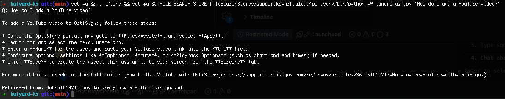

# kb-sync

Scrapes a Zendesk help center into clean Markdown and keeps a Gemini File Search store in sync, uploading only what changed. The store backs a support assistant that answers with cited article URLs.

**Daily job logs:** [all runs](https://github.com/hieubm1707/halyard-kb/actions/workflows/daily-sync.yml) · [latest verified run](https://github.com/hieubm1707/halyard-kb/actions/runs/42184836812) (`added=0 updated=0 skipped=398`)



_Screenshot from `ask.py`, which runs the assistant's exact configuration: the system prompt in `docs/system-prompt.txt` plus File Search over the synced store._

## Setup

Needs Python 3.12 or Docker, and a Gemini API key from Google AI Studio.

```bash
cp .env.sample .env        # then set API_KEY
```

## Run locally

```bash
# Docker: runs once and exits 0
docker build -t kb-sync .
docker run --rm --env-file .env kb-sync

# Python
pip install -r requirements.txt
python main.py --dry-run   # scrape and convert only, no key needed
set -a; . ./.env; set +a; python main.py
python ask.py "How do I add a YouTube video?"

# Tests
pip install pytest && python -m pytest
```

Clean Markdown is saved to `articles/<id>-<title>.md`. `samples/` holds a few examples.

## Assistant

The assistant is Gemini with the system prompt in `docs/system-prompt.txt` and the File Search tool pointed at the store the job logs (`fileSearchStores/...`). `ask.py` runs exactly that setup.

## How it works

- **Scrape:** the Zendesk API returns article bodies without nav or ads, so cleanup targets what remains: scripts, base64 images, stray markup. Embedded videos become links.
- **Chunking:** white-space chunking, 400 words with 60 overlap. Gemini counts words here, not model tokens, and caps a chunk at 512. The median article is about 570 words and mostly short procedures, so this keeps a step and its context together, with enough overlap to survive a split.
- **Citations:** the chunker ignores document structure, so a URL at the top of a file would reach only the first chunk. The upload copy repeats the `Article URL:` line often enough that every chunk has one. Tests assert this, and the files in `articles/` stay clean.
- **Delta:** each document in the store carries its article ID and a SHA-256 of its content as custom metadata. A run compares against these, so it needs no database and works from a fresh container. Hashing content, not `updated_at`, skips metadata-only edits.
- **Safe updates:** a new version is uploaded before the old one is deleted, so a failed upload leaves the article searchable. The next run clears anything an interrupted run left behind and retries what failed.
- **Removals:** articles gone from the source are removed so the bot stops citing them (not requested, but stale answers are worse). This is off when `MAX_ARTICLES` is set.
- **Logs:** each run logs `added`, `updated`, `skipped`, `removed`, `failed`, plus files and chunks. The API reports no chunk count, so chunks are computed from the same word settings and logged as `~`.
- **Schedule:** GitHub Actions builds the Dockerfile and runs it daily, with the key in repository secrets. Any failed upload exits non-zero and fails the run.

## Not done

- Anchor links such as `#steps` are preserved, but their targets are not, because Markdown output drops heading IDs.
- Text in images is not extracted.
